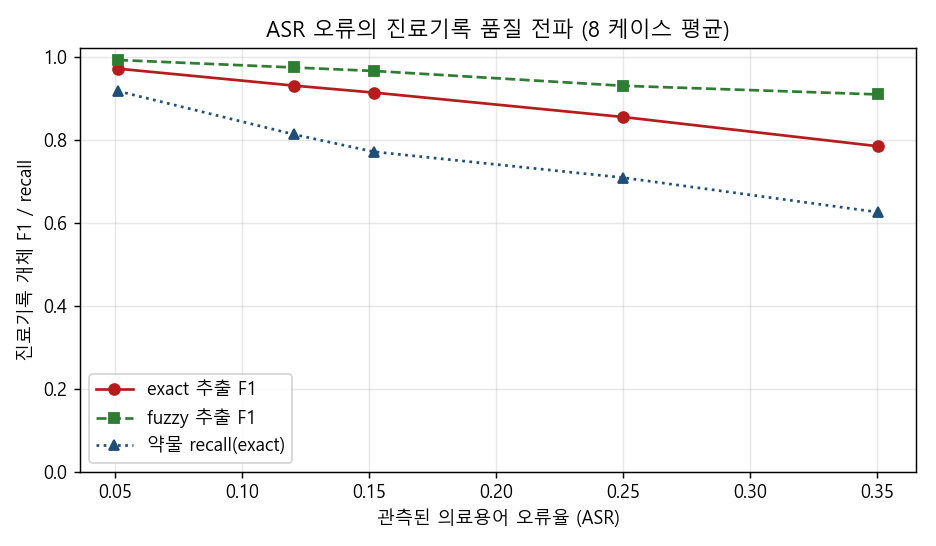

# clinical-note-pipeline — 진료 대화 → ASR → 구조화 진료기록 (NER/RE·오류 전파 실측)

> 의료진-환자 **대화**를 **구조화 진료기록**(증상·약물·진단 개체 + 관계 + 부정/시점)으로 자동 변환하는
> 파이프라인. 단순히 "돌아간다"가 아니라, **ASR 오류가 최종 진료기록 품질로 얼마나 전파되는지**를 통제
> 실험으로 측정하고, **실제 Whisper로 그 전제를 검증**하며, 임상 ASR의 함정(일반 WER가 좋아도 의료
> 용어는 무너진다)을 수치로 드러낸다. NER을 넘어 **관계 추출(RE)·부정(negation)·시점(temporal)**과
> **LangGraph 오케스트레이션**(불확실하면 사람에게)까지 포함한 임상 정보추출 파이프라인.



> **핵심 한 줄**: 실제 Whisper 실측에서 **일반 WER는 28%인데 의료용어 오류율은 60%**(2.1×) — 영문
> 약물명 `budesonide`가 **"1000명은"**으로 통째 붕괴. "WER 좋으면 좋은 ASR"이 임상에선 위험하다는 걸
> 시뮬이 아니라 *실모델*로 확인했다.

## ① 목표·이유
네이버 등 **AI 진료기록 생성** 과제의 코어 = 대화→기록 변환의 성능 고도화. 이런 캐스케이드
파이프라인(ASR→NER/추출→구조화)의 실무 난제는 **단계 간 오류 전파**다. 앞단 ASR이 약물명 하나를
틀리면 뒷단이 아무리 좋아도 그 약은 기록에서 사라진다. "무엇이 최종 품질을 결정하는가"를
*추측이 아니라 통제 실험*으로 답하는 것이 목표.

## ② 상품성 / 왜 가치 있는가
- **대상**: 의료 음성기록(EMR voice) 팀. 의료진 문서 작업 부담을 대화 자동 기록으로 경감.
- **가치**: 캐스케이드 시스템에서 **ASR 예산을 어디에 써야 하는가**(일반 정확도 vs 용어 정확도)를
  데이터로 판단. 임상에서 **약물 누락은 처방 오류로 직결**되므로 term-level 지표가 실제 안전과 연결.
- **도메인 진정성**: 의료기기 연구(ISO 13485) 배경 위에서 "결과를 임상 기준으로 검증"하는 관점.

## ③ 설계 채용 근거
| 결정 | 이유 |
|---|---|
| **정답 기록 → 대화 역생성** | 실제 진료 음성은 PHI(개인정보)라 공개 데이터 극소(정직한 제약). 정답 구조화 필드에서 대화를 생성하면 파이프라인 출력과 비교할 **ground truth가 정의상 존재** |
| **일반 WER vs 의료용어 오류율 분리** | ASR 실패는 용어·영문 약물명에 집중 → 두 지표를 분리해야 "무엇이 품질을 죽이는가"가 보임 |
| **결정적 오류 주입 시뮬** | 실제 Whisper는 무작위·환경 의존이라 인과 분리가 어렵다. 용어/일반 오류율을 *독립 제어*하는 결정적 시뮬로 전파를 인과적으로 측정(실제 Whisper는 `--whisper` 선택 훅) |
| **개체 P/R/F1 + 환각율** | 누락(recall↓, 처방 누락 위험)과 환각(없는 개체 지어냄, 오진 위험)을 분리 — 임상 안전의 두 실패 모드 |
| **longest-match-wins 중첩 해소** | '야간 기침'이 있으면 부분인 '기침'은 버림(nested entity, NER 표준) — 오탐 방지 |
| **관계추출(RE)+부정+시점** | 네이버 Required가 NER**/RE** — 개체만이 아니라 INDICATES/TREATS/ONSET 관계 복원. 부정('없음')은 임상 안전 직결이라 제외 |
| **LangGraph 오케스트레이션** | 단계를 명시적 StateGraph로 엮고 검증 노드가 needs_human 게이트 — "불확실하면 사람에게"(임상 필수) + Preferred 스킬 |

## ④ 성능 비교 (실측 — 8 케이스 평균, 결정적)
의료용어 오류율(term_er)을 스윕하며 최종 진료기록 개체 F1이 무너지는 곡선(`python run_pipeline.py`):

| 설정 term_er | 관측 일반 WER | 관측 용어 오류율 | exact 추출 F1 | 약물 recall | fuzzy 추출 F1 |
|---:|---:|---:|---:|---:|---:|
| 0.00 | 0.017 | 0.051 | 0.971 | 0.917 | **1.000** |
| 0.10 | 0.032 | 0.120 | 0.930 | 0.812 | 0.982 |
| 0.20 | 0.037 | 0.152 | 0.913 | 0.771 | 0.974 |
| 0.30 | 0.057 | 0.250 | 0.854 | 0.708 | 0.938 |
| 0.50 | 0.074 | 0.350 | 0.784 | **0.625** | 0.917 |

**핵심 발견(정직):**
1. **일반 WER는 임상 ASR을 오도하는 지표다.** term_er 0.5에서도 **일반 WER는 7.4%로 "좋아" 보이지만**,
   의료용어 오류율은 35%·**약물 recall은 0.625**로 무너진다. 즉 "WER 7%면 훌륭한 ASR"이라는 통념이
   진료기록에선 위험 — **약 3개 중 1개 이상이 기록에서 누락**된다. 임상 ASR은 term-level로 평가해야 한다.
2. **오류가 그대로 전파된다.** exact 추출 F1이 0.971→0.784로 단조 하락 — 앞단 ASR 용어 오류가 뒷단
   추출로 직접 번짐(캐스케이드 시스템의 구조적 취약). 추출기를 아무리 좋게 해도 없는 개체는 못 만든다.
3. **약물(영문 성분명)이 가장 약한 고리.** 고노이즈서 약물 recall 0.625로 증상보다 크게 떨어짐 —
   ASR이 영문 약물명에 가장 취약하고, 이것이 임상적으로 가장 위험한 누락.
4. **퍼지 매칭이 대부분 복원하나 완전하진 않다(정직한 절충).** 문자 유사도 추출로 F1 0.784→**0.917**
   (+0.133) 회복 — 글자 하나 틀린 약물명은 살리지만, 통째로 다른 단어로 인식된 용어는 못 살린다.
   → 실무 함의: **ASR 후처리(용어 정규화/사전 매칭)가 재학습보다 비용 대비 효과적인 첫 수**.

> 정직한 범위: 합성 대화·8 케이스·개체 단위 평가. 실제 임상 언어의 변이(동의어·축약·오탈자)는 이보다
> 복잡하다. 이 실험의 결론은 절대 수치가 아니라 **전파의 방향·기울기와 "일반 WER≠임상 품질"이라는
> 구조적 통찰**이다(아래 ④-b에서 실제 Whisper로 이 전제를 검증).

## ④-b 관계 추출(RE)·부정·시점 — NER을 넘어선 임상 정보추출 (실측)
네이버 Required가 "Entity Recognition **/ Relation Extraction** 등의 NLP"라 개체만이 아니라 **관계**를
복원한다: 증상 `INDICATES` 진단 · 약물 `TREATS` 진단 · 진단 `ONSET` 시점. 그리고 임상 안전에 직결되는
**부정(negation)** — '통증은 없습니다'를 개체로 뽑으면 오진이므로 제외한다.

위 스윕 표의 `관계 F1`·`부정rec` 열이 결과다:

**핵심 발견(정직):**
5. **관계는 개체보다 훨씬 빨리 무너진다.** term_er 0.5에서 개체 F1 0.784인데 **관계 F1은 0.198**.
   관계 (head, rel, tail)는 **양 끝점이 모두 맞아야** 성립하는데, 모든 관계가 *진단*을 공유 endpoint로
   가지므로 **진단 하나만 ASR에 깨져도 그 건의 관계가 전멸**(오류가 복리로 누적). RE가 NER보다 ASR에
   구조적으로 취약함을 수치로 보임 — 캐스케이드에서 **뒷단 구조가 복잡할수록 앞단 오류에 더 민감**.
6. **부정 검출은 강건하다(부정rec 1.000 유지).** 부정 단서('없습니다')는 *의료 용어가 아니라* 흔한
   기능어라 용어 집중 오류의 영향을 안 받는다 → 무엇이 강건하고 무엇이 취약한지가 **"오류가 어디에
   집중되는가"로 갈린다**는 통찰과 정합. (정직한 한계: 부정 *대상* 증상어 자체가 심하게 깨지면 놓칠 수 있음.)

## ④-c 실제 Whisper 검증 — 시뮬의 전제는 진짜인가 (실측, TTS→Whisper)
결정적 시뮬이 "용어에 집중된 실패"를 *가정*했다면, 그게 실제 모델에서도 사실인지 검증한다. 합성 대화를
**SAPI5 한국어 TTS(Heami)로 음성화 → faster-whisper(base)로 전사** → 실측 WER·용어 오류율(`python real_asr.py`):

| 지표 | 실측(8 케이스 평균) |
|---|---:|
| 일반 WER | **0.283** |
| 의료용어 오류율 | **0.603** (일반의 2.1×) |

대표 오인식(실제 Whisper 출력):
- `salbutamol`·`budesonide` → **"1000명은"** (영문 약물명 통째 붕괴 — 임상적으로 가장 위험한 누락)
- `배뇨통`→`배뉴통` · `빈뇨`→`빌뉴` · `속쓰림`→`속스림` · `콧물`→`콩물` (의료 용어 집중 오류)
- c5(천식) 용어 오류율 **1.000** = 그 건의 모든 약물·증상 소실

**결론: 시뮬은 strawman이 아니었다.** 실제 Whisper도 **일반 WER(28%)보다 의료용어 오류(60%)가 2배
이상** — "일반 WER는 좋아 보여도 임상 개체는 무너진다"는 전제가 *실모델로 재현*됐다. 시뮬의 인과 분리
결론(전파의 방향·기울기)이 현실에 정박된다. (정직한 caveat: TTS 합성음은 실제 진료 잡음·억양이 없어
실제 임상 WER의 하한 — 방향성 검증에 의미, 절대 수치는 아님.)

## ④-d 오케스트레이션 — LangGraph StateGraph (ASR→추출→관계→검증 게이트)
흩어진 단계를 **명시적 상태 그래프**로 엮는다(`pipeline/orchestrate.py`, 네이버 Preferred: LangGraph):
`asr → extract → relations → validate → END`. 마지막 검증 노드가 **needs_human 게이트**를 건다 —
진단 결측·약물 0개·관계 복원 실패 시 자동 확정 대신 **사람 검토로 라우팅**(감사 사유 state에 기록).
임상 시스템 원칙 "불확실하면 사람에게"를 구조로 강제(inspection-copilot supervisor 패턴 재사용).
실측: clean 건은 게이트 통과(dx·관계 확보), 고노이즈 건은 needs_human=True(진단 결측·관계 복원 실패).

## ⑤ 교체·디버깅 기록
- **중첩 개체 오탐 발견 → longest-match-wins 도입**: clean 전사인데도 c5(천식) F1이 0.93으로 새어,
  원인이 '기침'(c1 개체)이 '야간 기침'(c5 개체)의 부분문자열로 **동시 매칭돼 오탐**임을 진단 →
  더 긴 매칭에 포함되는 개체를 버리는 nested-entity 해소를 넣어 clean=완벽(F1 1.0) 회복. (테스트가
  파이프라인 상한을 강제해 이 누수를 잡음 — `test_clean_extraction_is_perfect`.)
- **평가 지표를 일반 WER → 용어 오류율로 분리**: 처음엔 WER만 봤으나 "WER 7%인데 약이 사라진다"는
  괴리를 설명 못함 → **term_error_rate를 분리 측정**해 괴리의 정체(용어 집중 오류)를 규명. 측정
  지표의 선택이 결론을 바꾼 사례.
- **결정적 시뮬 → 실제 Whisper로 전제 검증**: 실제 ASR은 인과 분리(용어 vs 일반 오류)가 불가 → 통제
  시뮬을 1차로 쓰되, "용어 집중 실패"라는 *전제 자체*가 사실인지 실제 Whisper(TTS→전사)로 검증 →
  일반 WER 0.283 vs 용어 오류율 0.603으로 **전제 재현 확인**(시뮬이 strawman이 아님). [[zero-cost-constraint]]
- **부정(negation)을 추출기에 통합**: 부정 소견을 넣자 clean 전사인데도 '호흡곤란은 없습니다'의 '호흡곤란'이
  개체로 새어 오탐 → NER 매칭 후 `detect_negations`로 후치 부정 단서(window)를 검사해 제외 → clean=완벽
  회복. NER은 문자열 매칭만으론 임상에서 위험(부정=오진)함을 실증.
- **관계 F1이 개체보다 급락하는 원인 규명**: 관계가 개체보다 빨리 무너지는 걸 보고, 원인이 *모든 관계가
  진단을 공유 endpoint로 가져 진단 손상이 전 관계로 전파*됨임을 진단 → "뒷단 구조가 복잡할수록 앞단
  오류에 민감"이라는 캐스케이드 통찰로 정리(측정이 구조적 취약성을 드러냄).

## ⑥ 에러 대처 / 정직한 범위
- 순수 함수(WER·term_error_rate·prf·match_entity)를 분리해 단위테스트 8개 — 지표 정의를 합성 입력으로 강제.
- PHI 제약을 정면으로 다룸: 실데이터 없이 정답→대화 역생성으로 ground truth 확보(합성의 한계는 명시).
- Whisper/Gemini는 지연 임포트 + 주입형 인터페이스라 **미설치·무키 환경에서도 핵심 실험이 재현**.

## ⑦ 개발 순서
정답 케이스 스키마(SOAP 개체+관계+부정+시점) 설계 → 대화 역생성 → WER·용어오류율 순수 지표 →
결정적 ASR 오류주입 시뮬(용어/일반 분리) → 렉시콘 추출기(+중첩 해소·퍼지) → **관계추출(RE)·부정·시점** →
개체·관계 F1·부정 recall·환각율 평가 → **오류 전파 스윕**(관계가 개체보다 급락 규명) → **LangGraph
오케스트레이션(needs_human 게이트)** → **실제 TTS→Whisper로 전제 검증**(일반 28% vs 용어 60%) →
(중첩·부정 오탐 진단·수정) → 순수함수 단위테스트(16개).

---

## 🎯 30초 피치
> "의료진-환자 **대화를 구조화 진료기록으로 바꾸는 파이프라인**(NER+관계추출+부정+시점)을 만들고, 단계
> 간 **오류 전파를 통제 실험 + 실제 Whisper로 측정**했습니다. 핵심은 **실제 Whisper에서 일반 WER는 28%인데
> 의료용어 오류는 60%**(영문 약물명 budesonide가 '1000명은'으로 붕괴) — 임상 ASR을 일반 WER로 평가하면
> 처방 누락을 놓칩니다. ASR 오류가 개체 F1을 0.97→0.78로 갉고, **관계는 진단 공유 endpoint 탓에 0.85→0.20으로
> 더 급락**했죠. 퍼지 후처리로 0.92까지 복원되지만 불완전해 '재학습보다 용어 정규화가 첫 수'라는 결론까지.
> 전체를 **LangGraph StateGraph로 오케스트레이션**하고 불확실하면 사람 검토 게이트를 걸었으며, 16개
> 순수함수 단위테스트로 지표를 강제했습니다."

## 실행
```bash
python run_pipeline.py            # 오류 전파 스윕(결정적, 키·오디오 불필요)
python run_pipeline.py --demo     # 케이스 1건 전 과정(clean→noisy→추출→채점)
python -m pytest -q               # 단위테스트 16개(langgraph 없으면 오케스트레이션 2개 skip)
python real_asr.py                # 실제 TTS→Whisper WER (pip install faster-whisper pyttsx3)
# 선택: 무료 Gemini 키            → LLMExtractor로 운영형 추출 경로
```

## 파이프라인 구성
```
대화(정답→역생성) → [asr] ASR/오류주입 → [extract] NER(+부정·중첩해소·퍼지)
                  → [relations] RE(INDICATES/TREATS/ONSET) → [validate] needs_human 게이트
```
`pipeline/orchestrate.py`가 위를 LangGraph StateGraph로 엮는다. 평가=개체 P/R/F1·관계 F1·부정 recall·환각율.

관련: [[decision-log-and-tradeoffs]] · 네이버 진료기록생성 공고 정조준(NER/RE·ASR·Clinical NLP 갭 축소)
